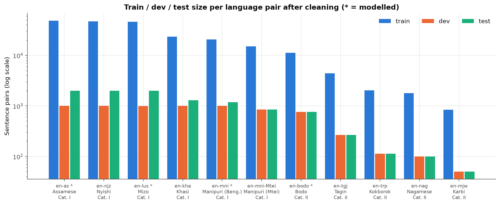
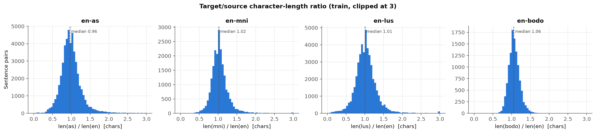
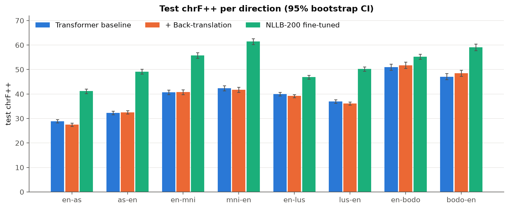
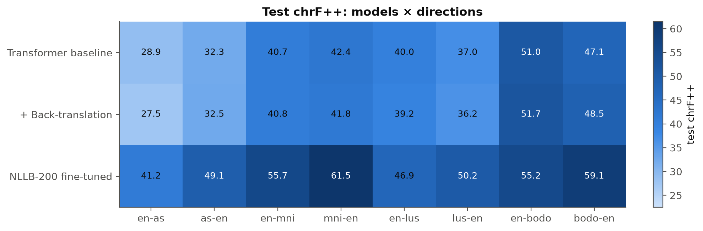
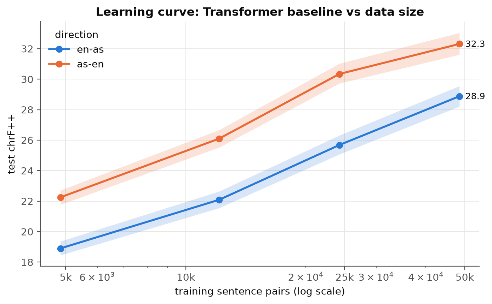
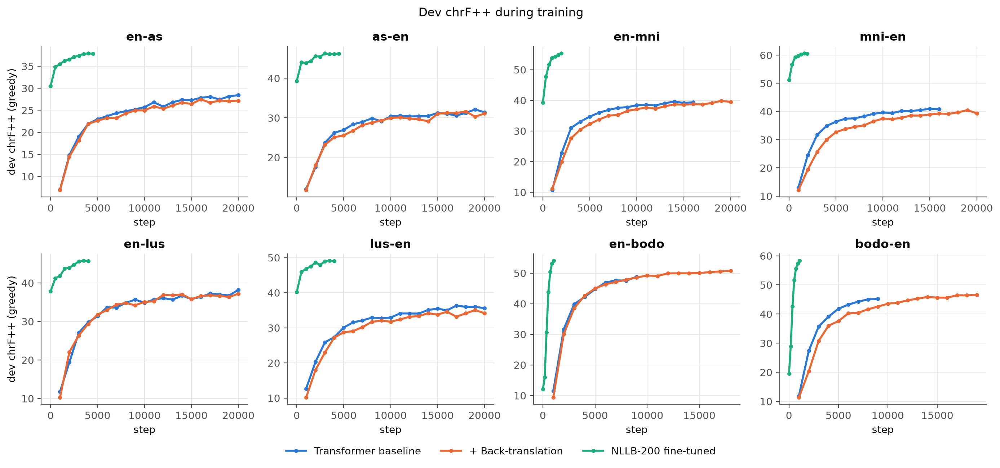

# Low-Resource NMT on the WMT26 Indic MT Task

English ↔ Assamese, Manipuri, Mizo and Bodo: a Transformer baseline, back-translation, and NLLB-200 fine-tuning.

> Full write-up: [`reports/final_report.md`](reports/final_report.md) · Results table: [`reports/results/results_table.md`](reports/results/results_table.md) · Error analysis: [`reports/error_analysis.md`](reports/error_analysis.md)

## 1. Project overview
The [WMT26 Shared Task on Low-Resource Indic Language Translation](https://www2.statmt.org/wmt26/indic-mt-task.html)
asks for translation between English and 11 north-east Indian languages that have very little parallel data.
We model **8 directions: en↔as, en↔mni, en↔lus and en↔bodo**, and compare three systems:

| System | Idea | Code |
|---|---|---|
| Transformer baseline | small pre-norm Transformer (9.4M parameters) trained from scratch | `src/models/baseline/` |
| + Back-translation | baseline plus 1:1 tagged synthetic data (BT for X→en, forward translation for en→X) | `src/models/advanced/backtranslation.py` |
| NLLB-200 fine-tuned | full fine-tuning of `nllb-200-distilled-600M` | `src/models/advanced/nllb_finetune.py` |

**Headline:** NLLB fine-tuning averages **52.4 chrF++** (COMET 74.3), against 39.9 (COMET 64.6) for the baseline, and is
significantly better in every direction. Back-translation helps only the smallest pair (Bodo) and
slightly hurts the others. That is an honest negative result, explained in §8.

## 2. Team and contributions
| Member | SAP ID | Role | Contribution |
|---|---|---|---|
| Amulya Jain | 500122439 | M1 Data collection | download, checksums, alignment checks, raw splits, `docs/SOURCES.md` (`src/data/`) |
| Himanshu Pokhriyal | 500121200 | M2 Preprocessing & EDA | cleaning, script checks, SentencePiece, EDA figures (`src/preprocess/`, `src/eda/`) |
| Anirvan Ranjan | 500119330 | M3 Baseline | Transformer, beam search, training loop, learning curve (`src/models/baseline/`) |
| Narind Verma | 500121898 | M4 Advanced models | back-translation pipeline, NLLB-200 fine-tuning (`src/models/advanced/`) |
| Somansh Goel | 500123667 | M5 Evaluation & integration | metrics, bootstrap/significance, error analysis, figures, report, repo (`src/eval/`, `src/viz/`) |

Subject: Computational Linguistics and Natural Language Processing Lab · Faculty: Dr Sahinur Rehman Laskar · Institution: University of Petroleum and Energy Studies (UPES)

## 3. Dataset
- **Source:** the official WMT26 Indic MT **2026** training release (Google Drive folder linked from the task page).
  Provenance, checksums and licence are in [`docs/SOURCES.md`](docs/SOURCES.md).
- **Licence:** none stated by the organisers. We use the data for research only and do not redistribute it;
  `data/` is regenerated by `bash run.sh data`.
- **Splits:** the official test sets are password-protected for registered teams, so dev and test are
  **held out from the training release** with seed 42. Overlapping pairs are removed from train. See
  [`docs/task_notes.md`](docs/task_notes.md) for this assumption.

| Pair | Language (script) | Category | Train | Dev | Test |
|---|---|---|---:|---:|---:|
| en-as | Assamese (Bengali-Assamese) | I | 48,521 | 1,000 | 2,000 |
| en-mni | Manipuri (Bengali) | I | 20,759 | 1,000 | 1,184 |
| en-lus | Mizo (Latin) | I | 46,369 | 999 | 2,000 |
| en-bodo | Bodo (Devanagari) | II | 11,272 | 760 | 760 |

The other 7 released pairs are cleaned and covered by the EDA but not modelled (the reasons are in `docs/task_notes.md`).

## 4. Setup
- **Local** (data, EDA, evaluation, figures; CPU only). The environment is managed with [uv](https://docs.astral.sh/uv/):
  ```bash
  bash run.sh setup        # = uv venv --python 3.11 .venv && uv pip install -r requirements.txt
  ```
  Tested on Windows 11 with Python 3.11.15, and on Linux.
- **GPU training** ran on hosted notebooks:
  - `notebooks/01_baseline_and_backtranslation.ipynb`: Colab, 1× A100-40GB, about 4.8 h.
  - `notebooks/02_nllb_finetune.ipynb`: Kaggle, T4, about 7 h.

  Their extra pins are in `requirements-gpu.txt`. Every run records its hardware in `run_config.json`.

## 5. How to reproduce
```bash
bash run.sh data          # M1  download 2026 release -> data/raw/{pair}/{split}.{src,tgt} + SOURCES.md
bash run.sh preprocess    # M2  clean + SentencePiece -> data/processed/{pair}/
bash run.sh eda           # M2  reports/figures/eda/ + reports/eda_summary.md
bash run.sh bundle        # zip code + processed data -> dist/nmt_bundle.zip (upload to Kaggle/Colab)
# GPU: run notebooks/01_*.ipynb then 02_*.ipynb (they skip finished runs), unzip *_results.zip here.
#      Or one direction at a time on any GPU machine:
bash run.sh baseline en-as
bash run.sh bt as-en       # generates outputs/synthetic/en-as first if missing
bash run.sh nllb en-as     # on a 16 GB GPU add: --batch-size 4 --grad-accum 8 if it runs out of memory
bash run.sh comet          # optional, GPU
bash run.sh eval           # M5  scores + 1000x bootstrap CIs + significance + error analysis
bash run.sh figures        # M5  reports/figures/results/
bash run.sh presentation   # rebuild the slide deck data; open presentation/index.html
node presentation/build_pptx.js   # PowerPoint version -> presentation/NMT_Presentation.pptx (needs: npm install pptxgenjs@3.12.0)
```
All seeds are 42 and are recorded in `run_config.json`. Preprocessing is deterministic: single-threaded
SentencePiece, no shuffling.

## 6. Preprocessing and EDA
- **Normalisation:** NFC; removal of invisible characters (ZWSP, BOM, soft hyphen, word joiner) while
  keeping ZWJ/ZWNJ; whitespace normalisation. A check of broken combining marks confirms Indic text is
  not corrupted.
- **Train-only filters** (`configs/preprocess.yaml`): empty or identical pairs, over 150 words,
  character ratio above 3, under 50% of the expected script, duplicates, and overlap with dev/test.
- **Tokeniser:** joint en+X SentencePiece unigram per pair, 8k vocabulary (6k for Bodo), trained on
  train only. A shared vocabulary allows tied embeddings and copying of names and numbers.




More figures (length distributions, OOV, Zipf, word clouds) and tables are in [`reports/eda_summary.md`](reports/eda_summary.md).

## 7. Models and training
| | Baseline / BT | NLLB-200 fine-tuning |
|---|---|---|
| Architecture | pre-norm Transformer, d 256, 4 heads, FFN 1024, 4+4 layers, tied embeddings | `nllb-200-distilled-600M` (615M parameters) |
| Regularisation | dropout 0.3, attention dropout 0.1, label smoothing 0.1, early stopping (patience 6) | label smoothing 0.1, early stopping (patience 4) |
| Optimiser | AdamW 0.9/0.98, lr 7e-4, inverse-sqrt decay, 2k warm-up, about 6k tokens per batch | AdamW, lr 5e-5, 300 warm-up steps, linear decay, effective batch 32 |
| Budget | at most 20k steps, model selection on dev chrF++ every 1k steps | at most 3 epochs / 4.5k steps, dev chrF++ on 300 sentences |
| Decoding | beam 5 | beam 4 |
| Language tags | `<BT>` on synthetic sources | `asm_Beng`, `mni_Beng`, `lus_Latn`, **`hin_Deva` as a proxy for Bodo** |

Back-translation data comes from 151k–187k English sentences taken from the other released pairs. It is
mixed 1:1 with the real data, so 11k–49k synthetic pairs are added. Synthetic-data quality (round-trip
chrF++ of 20–27) is reported in `outputs/synthetic/*/quality.json`.

## 8. Results
Test chrF++ with 95% bootstrap CIs (1,000 resamples). `*` / `†` mark a result significantly better / worse
than the baseline (paired bootstrap, one-sided p < 0.05).

| Direction | Baseline | + Back-translation | NLLB-200 fine-tuned |
|---|---:|---:|---:|
| en-as | 28.88 [28.2, 29.6] | 27.50† [26.8, 28.2] | **41.17\*** [40.2, 42.0] |
| as-en | 32.31 [31.6, 33.0] | 32.54 [31.9, 33.3] | **49.14\*** [48.2, 50.2] |
| en-mni | 40.70 [39.8, 41.7] | 40.76 [39.8, 41.7] | **55.72\*** [54.6, 56.9] |
| mni-en | 42.38 [41.4, 43.4] | 41.75† [40.8, 42.8] | **61.47\*** [60.3, 62.6] |
| en-lus | 39.96 [39.3, 40.6] | 39.21† [38.6, 39.8] | **46.90\*** [46.1, 47.7] |
| lus-en | 36.95 [36.2, 37.6] | 36.16† [35.5, 36.8] | **50.22\*** [49.3, 51.1] |
| en-bodo | 50.99 [49.7, 52.2] | 51.74\* [50.4, 53.0] | **55.25\*** [54.2, 56.3] |
| bodo-en | 47.08 [45.9, 48.3] | 48.45\* [47.3, 49.7] | **59.07\*** [57.8, 60.4] |
| **Average (8 directions)** | 39.91 | 39.76 | **52.37** |

Averages over all 8 directions for every metric:

| | Baseline | + Back-translation | NLLB-200 fine-tuned |
|---|---:|---:|---:|
| **chrF++** (primary) | 39.91 | 39.76 | **52.37** |
| **BLEU** | 17.24 | 17.17 | **28.48** |
| **COMET** (wmt22-da, ×100) | 64.59 | 64.10 | **74.33** |

COMET agrees with chrF++ on the NLLB ranking in every direction. Metric signatures:
- chrF++: `nrefs:1|case:mixed|eff:yes|nc:6|nw:2|space:no|version:2.6.0`
- BLEU: `nrefs:1|case:mixed|eff:no|tok:13a|smooth:exp|version:2.6.0`
- COMET: `Unbabel/wmt22-comet-da`, system score = mean segment score ×100

The full BLEU and COMET tables and p-values are in `reports/results/`.






Other figures, all PNG + PDF in `reports/figures/results/`:
- loss curves per pair
- NLLB zero-shot vs fine-tuned
- sentence length vs score
- baseline attention

**Takeaways:**
1. Pretrained multilingual transfer dominates: +4 to +19 chrF++. NLLB even learns unseen Bodo through
   the Hindi tag (dev chrF++ goes from 12 to 55).
2. Back-translation from a weak generator adds noise. It helps only where real data is scarcest (Bodo, 11k pairs).
3. The learning curve gains about 3–4 chrF++ per doubling of data, with no plateau. The pairs are data-limited.

## 9. Error analysis
We take 64 low-scoring sentences per model and label them with reproducible rules
([`reports/error_analysis.md`](reports/error_analysis.md)).
- **About 1/3 of the worst cases are misaligned test pairs** inherited from the release, so the models
  are not at fault.
- **Omissions dominate for the scratch models** (36–37 of 64, against 31 for NLLB).
- **Hallucinations are mostly repetition loops** on lists of names.
- **BT increases named-entity errors** (5 → 9).
- **Script errors and untranslated copying are almost absent.**

## 10. Limitations and future work
- **Not leaderboard-comparable.** We use our own held-out test split, because the official one is password-protected.
- **Noisy test pairs.**
- **COMET is a weak signal for Manipuri, Mizo and Bodo.** Its XLM-R encoder has not seen those languages,
  so chrF++ stays the primary metric.
- **Possible pre-training overlap.** NLLB may have seen the public Bible/news text: it reproduces 2.4% of test references exactly, against 1.4% for the baseline.
- **Single seed.**
- **NLLB checkpoints not saved** (disk quota).

**Future work:**
- Back-translation with NLLB as the generator and tuned ratios.
- One multilingual model for all 11 pairs.
- Related-language transfer (as → mni).
- LoRA on larger NLLB models.
- A repetition penalty at decoding time.

## 11. Citations
- WMT26 Shared Task on Low-Resource Indic Language Translation, https://www2.statmt.org/wmt26/indic-mt-task.html. The data creators are credited in the organisers' "Language Resource Contributors" sheet.
- NLLB Team et al. (2022). *No Language Left Behind: Scaling Human-Centered Machine Translation.* arXiv:2207.04672. Model: `facebook/nllb-200-distilled-600M` (CC-BY-NC-4.0).
- Vaswani et al. (2017). *Attention Is All You Need.* NeurIPS.
- Sennrich et al. (2016). *Improving NMT Models with Monolingual Data.* ACL. Caswell et al. (2019). *Tagged Back-Translation.* WMT.
- Kudo & Richardson (2018). *SentencePiece.* EMNLP demo.
- Post (2018). *A Call for Clarity in Reporting BLEU Scores* (sacreBLEU). WMT. Popović (2017). *chrF++.* WMT.
- Rei et al. (2022). *COMET-22.* WMT. Koehn (2004). *Statistical Significance Tests for MT Evaluation.* EMNLP.
- PyTorch; 🤗 Transformers (Wolf et al., 2020).

---
Repository layout:
- `configs/`: all hyperparameters.
- `src/{data,preprocess,eda,models/baseline,models/advanced,eval,viz}`
- `scripts/`: notebook, bundle and presentation builders.
- `notebooks/`: GPU notebooks; `notebooks/colab_run/` holds the executed Colab runs.
- `outputs/`: test hypotheses, training curves (`train_log.csv`), run configs and COMET scores of every run.
- `reports/`: figures, results tables, error analysis, final report.
- `presentation/`: website (`index.html`) and slides (`NMT_Presentation.pptx`).
- `docs/`: `task_notes`, `interfaces`, `SOURCES`.

Not in git (see `.gitignore`): `data/` (licence; rebuilt with `bash run.sh data` and `bash run.sh preprocess`), model checkpoints, dev-set decodes, synthetic corpora, raw job logs and the local `.venv`.

Interfaces between stages are documented in [`docs/interfaces.md`](docs/interfaces.md).
