# Low-Resource Neural Machine Translation on the WMT26 Indic MT Task

**Team:** Amulya Jain (500122439), Himanshu Pokhriyal (500121200), Anirvan Ranjan (500119330), Narind Verma (500121898), Somansh Goel (500123667)
**Course / faculty / institution:** Computational Linguistics and Natural Language Processing Lab · Dr Sahinur Rehman Laskar · University of Petroleum and Energy Studies (UPES)

## Abstract
We build English↔X translation systems for four low-resource north-east Indian languages from the
WMT26 Indic MT 2026 release: Assamese, Manipuri (Bengali script), Mizo and Bodo, in 8 directions. We
compare three systems:
- a small Transformer trained from scratch;
- the same Transformer trained with back-translation / forward-translation;
- fine-tuned NLLB-200-distilled-600M.

Results on held-out test sets:
- **Fine-tuning NLLB-200 is by far the best system.** Average chrF++ over the 8 directions is 52.4
  against 39.9 for the baseline (COMET 74.3 against 64.6). The gain is +4.3 to +19.1 chrF++
  per direction, all significant at p < 0.05. NLLB even learns Bodo, which it has never seen, through
  a Hindi proxy tag.
- **Back-translation is a mixed result.** It helps Bodo, the smallest pair (+0.8 and +1.4 chrF++,
  significant). It slightly hurts the larger pairs (−0.6 to −1.4 on en-as, mni-en and both Mizo
  directions). The synthetic data is too noisy: round-trip chrF++ is only 20–27.
- A learning curve shows the baseline gains about 3–4 chrF++ per doubling of data with no plateau,
  so these pairs are clearly data-limited.

## 1. Introduction
Most of India's north-eastern languages have well under 100k sentence pairs of parallel text, which
puts them firmly in the low-resource regime for NMT. The WMT26 shared task on Low-Resource Indic
Language Translation releases parallel data for 11 such languages. We follow the course brief: a
from-scratch Transformer baseline and two improvements, chosen for the low-resource setting. The two
improvements are:
1. **Data augmentation through back-translation.** It needs no external resources.
2. **Transfer from a massively multilingual pretrained model.** It brings knowledge from 200
   languages, including close relatives of our targets.

## 2. Data (M1, M2)
Data: the official 2026 training release. Provenance and checksums are in `docs/SOURCES.md`, and the
EDA is in `reports/eda_summary.md`. The official test sets are password-protected for registered
teams. We therefore hold out our own dev and test sets with a fixed seed and remove every train
pair that overlaps them. This deviation is documented in `docs/task_notes.md`.

| Pair | Script (X) | Train (after cleaning) | Dev | Test | Removed from train |
|---|---|---:|---:|---:|---|
| en-as | Bengali-Assamese | 48,521 | 1,000 | 2,000 | 2,479 (1,014 dev/test overlap, 917 duplicates, 545 length ratio, 3 wrong script) |
| en-mni | Bengali | 20,759 | 1,000 | 1,184 | 744 |
| en-lus | Latin | 46,369 | 999 | 2,000 | 631 |
| en-bodo | Devanagari | 11,272 | 760 | 760 | 2,422 (1,932 duplicates) |

**Preprocessing** (`configs/preprocess.yaml`):
- Unicode NFC.
- Removal of zero-width space, BOM, soft hyphen and word joiner. ZWJ/ZWNJ are kept because they change
  Indic rendering. Whitespace is normalised.
- **Train only:** drop empty, identical and over-150-word pairs; drop pairs whose character ratio is
  above 3 (for pairs of at least 20 characters); drop pairs where under 50% of the letters are in the
  expected script; then exact deduplication.
- Dev and test are only normalised, so every system is scored on identical sentences.
- A broken-combining-mark check confirms that normalisation does not corrupt Indic text: the counts
  are equal before and after.

**Tokenisation:** one **joint** SentencePiece unigram model per pair, trained on the train split only.
- Vocabulary: 8k, or 6k for Bodo. Character coverage is 1.0, so every grapheme is kept.
- A joint vocabulary lets us tie the embeddings and copy names and numbers between languages, which
  matters for the many Latin-script names in the Bible-domain text.
- Average length is 24–27 pieces per sentence on both sides.

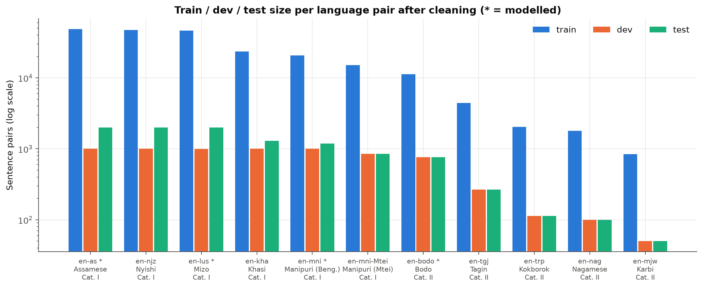
*Figure 1. Train/dev/test sizes for all 11 released pairs after cleaning. The four modelled pairs are marked.*

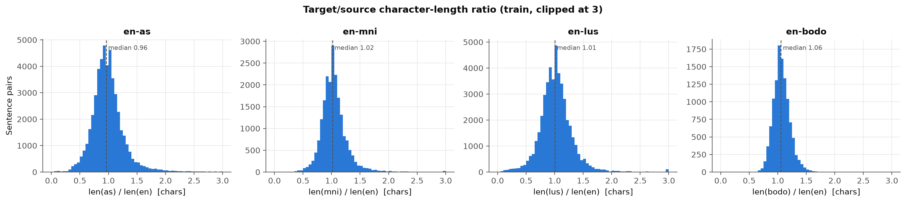
*Figure 2. Character-length ratio X/en on the training data. The medians are close to 1 for all four pairs,
and the 5–95% range is used to set the ratio filter.*

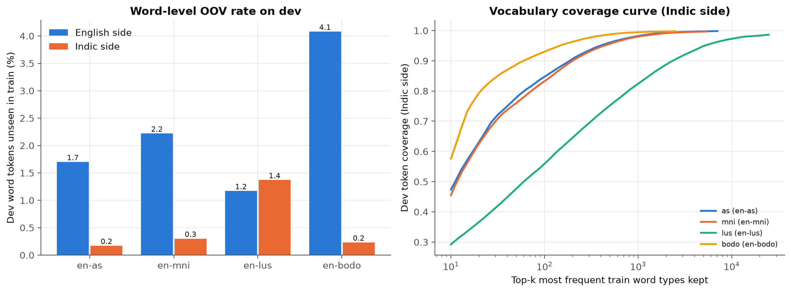
*Figure 3. Word-level OOV rate on dev and SentencePiece coverage. English OOV is highest for Bodo (4.1%),
the smallest corpus.*

Further EDA figures (character and token length distributions, Zipf plots, word clouds) and n-gram
tables are in `reports/figures/eda/` and `reports/eda_summary.md`.

## 3. Methods (M3, M4)

**Baseline Transformer (M3)**: `src/models/baseline/`, `configs/baseline.yaml`.
- Architecture: pre-norm encoder-decoder; d_model 256, 4 heads, FFN 1024, 4+4 layers, dropout 0.3,
  tied embeddings. About 9.4M parameters.
- This is the "small Transformer for limited data" configuration. Strong dropout and label smoothing
  (0.1) are the regularisers recommended for low-resource NMT.
- Optimisation: AdamW (β = 0.9/0.98), learning rate 7e-4 with inverse-square-root decay after 2k
  warm-up steps, batches of about 6k tokens, gradient clipping at 1.0.
- Training runs for at most 20k steps. Every 1k steps we evaluate dev chrF++ (greedy) and keep the best
  checkpoint; training stops early after 6 evaluations without improvement.
- Decoding: beam 5.

**Back-translation (M4-B)**: `src/models/advanced/backtranslation.py`.
- Monolingual pool: English sentences of 3–80 words from the *other* 10 released pairs, deduplicated
  and with dev/test sentences removed. That gives 151k–187k sentences per pair.
- **X→en (classic back-translation):** the baseline en→X model translates English monolingual text
  into synthetic X. The training pairs are (synthetic X, real English).
- **en→X (forward translation / self-training):** the pairs are (real English, synthetic X from the
  baseline).
- Synthetic data is mixed 1:1 with the real data and marked with a `<BT>` source tag (Caswell et al.,
  2019). The model and schedule are the same as the baseline.

| Pair | Synthetic pairs added | Round-trip chrF++ | Round-trip BLEU | Length ratio syn/src |
|---|---:|---:|---:|---:|
| en-as | 48,521 | 26.4 | 8.6 | 0.81 |
| en-mni | 20,759 | 19.6 | 2.6 | 0.86 |
| en-lus | 46,369 | 26.8 | 9.6 | 0.90 |
| en-bodo | 11,272 | 25.4 | 4.4 | 1.00 |

*Table 2. Quality of the synthetic data. Round trip: English → X (baseline) → English (baseline),
on 500 sentences.*

**NLLB-200 fine-tuning (M4-A)**: `src/models/advanced/nllb_finetune.py`, `configs/nllb.yaml`.
- Model: `facebook/nllb-200-distilled-600M` (615M parameters, CC-BY-NC-4.0).
- Language codes: `asm_Beng`, `mni_Beng`, `lus_Latn`. **Bodo has no NLLB code, so we reuse
  `hin_Deva`**, the same script, as a proxy.
- Training: full fine-tuning, effective batch 32, learning rate 5e-5 with 300 warm-up steps and
  linear decay, label smoothing 0.1, at most 3 epochs / 4.5k steps.
- Mixed precision: fp16 on T4, bf16 on A100. The loss is computed only on non-padding positions to fit
  16 GB.
- Model selection uses dev chrF++ on a fixed 300-sentence subset. We also record the zero-shot dev
  score at step 0. Decoding: beam 4.

**Reproducibility.**
- Every run writes `run_config.json` with the seed (42), all hyperparameters, hardware, wall-clock time
  and git hash, plus `train_log.csv`.
- Total GPU time was about 11.6 h: baseline, learning-curve and BT runs on one A100, NLLB on a Kaggle T4.

## 4. Experimental setup (M5)
- **Metrics:** chrF++ (primary), BLEU and, when available, COMET. Signatures:
  - chrF++: `nrefs:1|case:mixed|eff:yes|nc:6|nw:2|space:no|version:2.6.0`
  - BLEU: `nrefs:1|case:mixed|eff:no|tok:13a|smooth:exp|version:2.6.0`
- **Uncertainty:** 95% percentile bootstrap CIs over 1,000 test resamples (seed 42). Corpus scores are
  recomputed exactly from per-sentence sufficient statistics.
- **Significance:** paired bootstrap (Koehn, 2004) against the baseline, using the same 1,000 resamples
  for every system. p is one-sided in the direction of the observed difference.
- **Learning curve:** the baseline retrained on 10%, 25% and 50% of en-as / as-en.

## 5. Results

| Direction | Baseline | + Back-translation | NLLB-200 fine-tuned |
|---|---:|---:|---:|
| en-as | 28.88 [28.2, 29.6] | 27.50† [26.8, 28.2] | **41.17\*** [40.2, 42.0] |
| as-en | 32.31 [31.6, 33.0] | 32.54 [31.9, 33.3] | **49.14\*** [48.2, 50.2] |
| en-mni | 40.70 [39.8, 41.7] | 40.76 [39.8, 41.7] | **55.72\*** [54.6, 56.9] |
| mni-en | 42.38 [41.4, 43.4] | 41.75† [40.8, 42.8] | **61.47\*** [60.3, 62.6] |
| en-lus | 39.96 [39.3, 40.6] | 39.21† [38.6, 39.8] | **46.90\*** [46.1, 47.7] |
| lus-en | 36.95 [36.2, 37.6] | 36.16† [35.5, 36.8] | **50.22\*** [49.3, 51.1] |
| en-bodo | 50.99 [49.7, 52.2] | 51.74\* [50.4, 53.0] | **55.25\*** [54.2, 56.3] |
| bodo-en | 47.08 [45.9, 48.3] | 48.45\* [47.3, 49.7] | **59.07\*** [57.8, 60.4] |
| **Average (8 dirs)** | 39.91 | 39.76 | **52.37** |

*Table 3. Test chrF++ with 95% bootstrap CIs. `*` / `†` mark a result significantly better / worse
than the baseline (paired bootstrap, p < 0.05). BLEU shows the same ranking (average
17.2 / 17.2 / 28.5), with one exception: NLLB en-bodo BLEU is 23.0 against 22.6, which is not significant.
Full BLEU and COMET tables, CIs and p-values: `reports/results/results_table.md`,
`reports/results/significance.csv`.*

| Average over 8 directions | Baseline | + Back-translation | NLLB-200 fine-tuned |
|---|---:|---:|---:|
| chrF++ | 39.91 | 39.76 | **52.37** |
| BLEU | 17.24 | 17.17 | **28.48** |
| COMET (wmt22-comet-da ×100) | 64.59 | 64.10 | **74.33** |

*Table 4. All three metrics. COMET confirms the chrF++ picture: NLLB is significantly better than the
baseline in all 8 directions (+2.2 COMET on en-bodo up to +15.8 on as-en). Back-translation is
significantly better on COMET only for as-en and bodo-en, and significantly worse on en-as, en-mni,
mni-en and en-lus.*

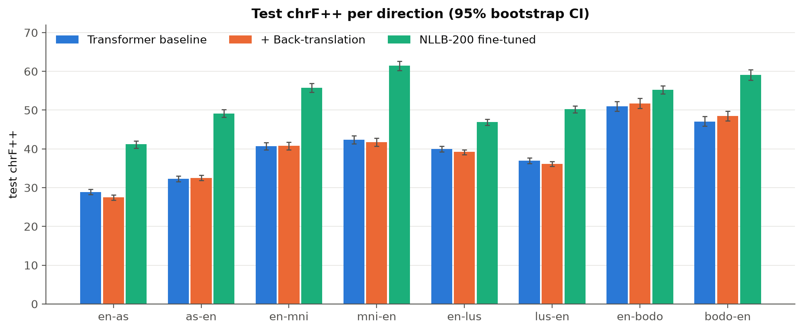
*Figure 4. Test chrF++ per direction and model, with 95% bootstrap CIs.*

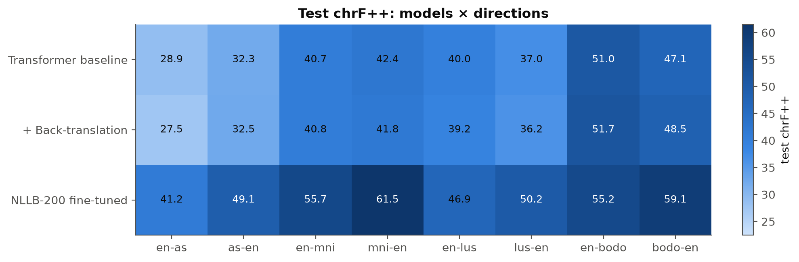
*Figure 5. Test chrF++, models × directions. The darker the cell, the better.*

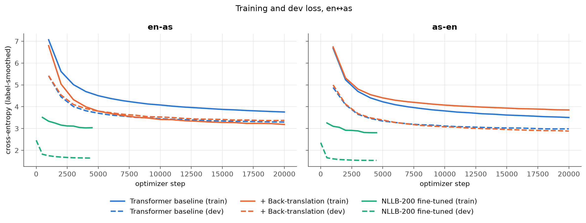
*Figure 6. Training (solid) and dev (dashed) loss for en↔as. The x-axis is optimizer steps; NLLB steps
are 32 sentences each, while baseline steps are about 6k tokens. Losses are on each model's own
vocabulary, so compare their shapes, not their levels. The other pairs are in
`figures/results/loss_curves_*.png`.*

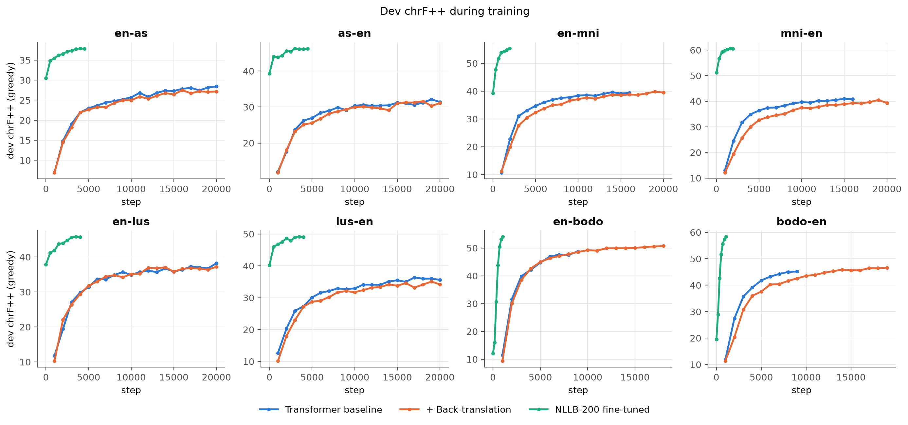
*Figure 7. Dev chrF++ (greedy) during training. NLLB starts above the converged baseline in every
direction except Bodo, where it starts from zero-shot 12–18 and overtakes the baseline within about
500 steps.*

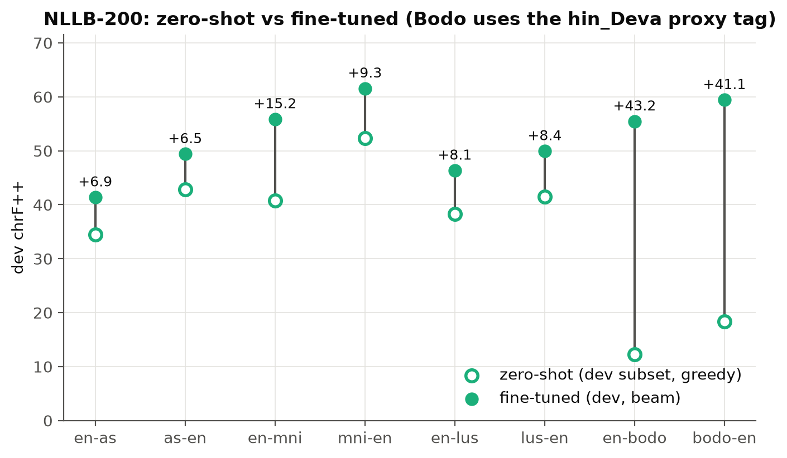
*Figure 8. NLLB-200 dev chrF++ before and after fine-tuning. Bodo, unseen and used under the `hin_Deva`
tag, gains more than 40 points.*

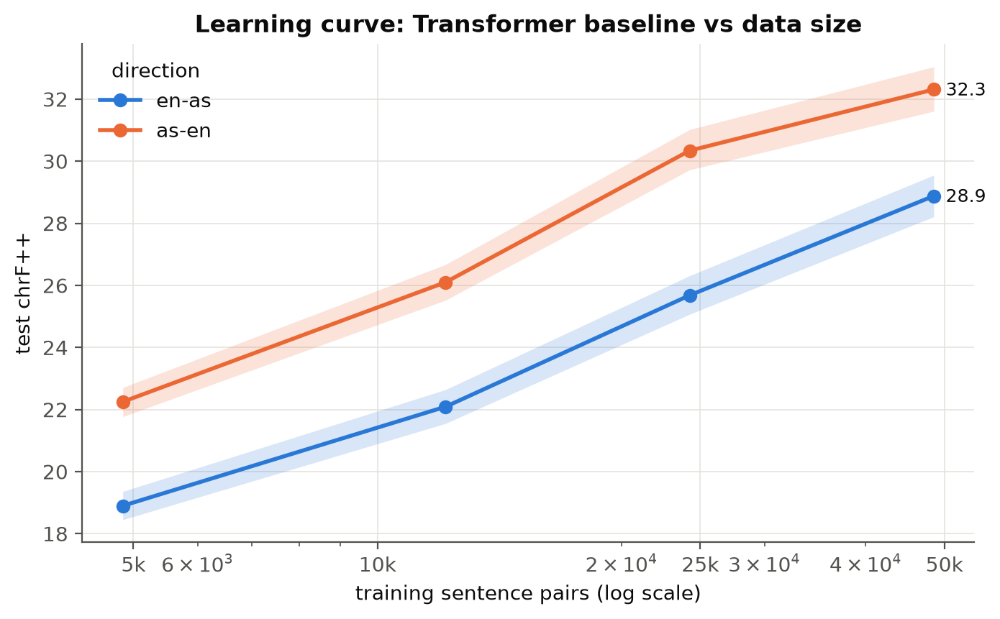
*Figure 9. Baseline test chrF++ against training size for en-as and as-en (log x-axis, 95% CI bands).
Each doubling adds about 3–4 chrF++, with no plateau at 48k pairs.*

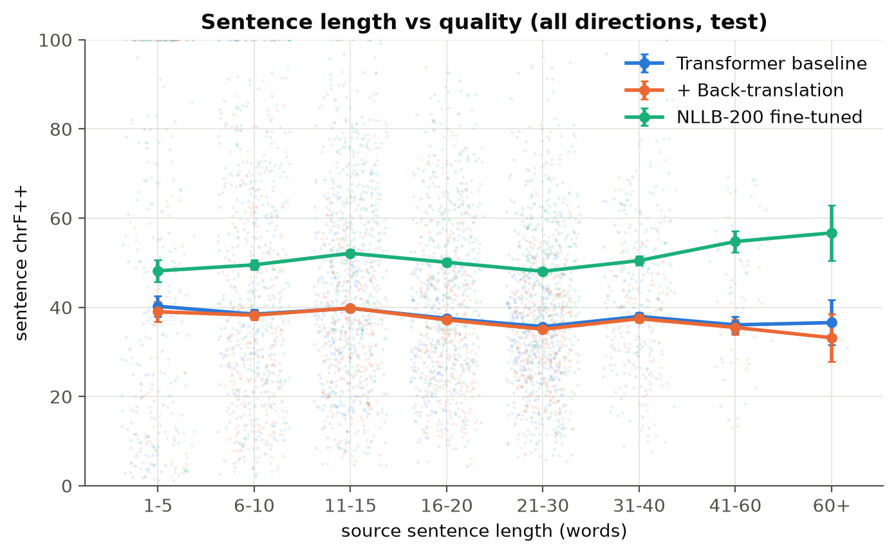
*Figure 10. Sentence-level chrF++ against source length (binned mean ± 95% CI; dots are individual
sentences). NLLB is better at every length; no model degrades sharply on long inputs within 60 words.*

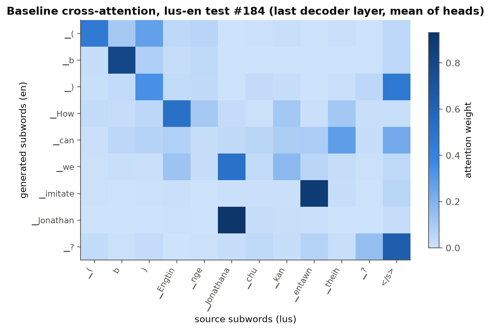
*Figure 11. Baseline cross-attention (last decoder layer, heads averaged) for a Mizo→English test
sentence (*"(b) Engtin nge Jonathana chu kan entawn theih?"* → "(b) How can we imitate Jonathan?").
Each row is the attention used to predict that output token. The alignment is close to monotonic:
"How" attends to "Engtin", "imitate" to "entawn", "Jonathan" to "Jonathana", and the final "?"
to `</s>`. "we" attends to "Jonathana" and "kan" (the 1st-person plural marker), reflecting the
different word order of Mizo (object before verb).*

## 6. Discussion
- **Transfer beats augmentation by a wide margin.** NLLB has seen Assamese, Manipuri and Mizo during
  pre-training, and even zero-shot it beats or matches our converged baselines on 6 of 8 directions (dev).
  The gains are largest into English (+13 to +19 chrF++), where its English decoder is strongest.
- **NLLB learns Bodo without ever having seen it.** It goes from 12 to 55 dev chrF++ in about 1k steps.
  Script-sharing with the proxy language (Hindi, Devanagari) plus 11k pairs is enough.
- **Why back-translation did not help.** It helped only on Bodo, where the real data is smallest
  (11k pairs), so even noisy extra data adds information. For the larger pairs, three things hurt it:
  1. The baseline generators are weak (round-trip chrF++ 20–27).
  2. The synthetic sentences are shorter than the sources (length ratio 0.81–0.90) and contain
     repetition loops.
  3. The English monolingual pool comes from other pairs' domains.

  At a 1:1 ratio this noise outweighs the benefit. Back-translation is known to need a reasonably
  good reverse model (Edunov et al., 2018). Better options would be a lower synthetic ratio,
  NLLB-generated synthetic data, or sampling instead of beam search.
- **Learning curve.** The baselines are strongly data-limited, which explains why a pretrained
  model, effectively "more data", wins.

## 7. Error analysis
Full details are in `reports/error_analysis.md`. We take the 8 lowest-scoring test sentences per
direction and model, which gives 64 per model, and label them
with reproducible rules. Main findings:
1. **About a third of the worst cases are misaligned test pairs**, inherited from the training release.
   The model is not at fault. NLLB frequently translates these correctly and still scores about 5 chrF++.
2. **Omission is the main real error of the scratch models** (36–37 of 64), against 31 of 64 for NLLB.
3. **Hallucinations are repetition loops on lists of names**, for example in genealogies. NLLB shows a
   few more (9 against 4–5).
4. **Back-translation increases named-entity errors** (5 → 9). The noisy synthetic data duplicates and
   drops names.
5. **Script errors and untranslated copying are practically absent** for all models.

## 8. Limitations and future work
- **Evaluation data.** We use our own held-out split, not the official test set, so the scores are not
  comparable to the leaderboard. The test pairs are noisy, too: about 1/3 of the worst cases are
  misaligned. A manually verified test subset would make the scores more meaningful.
- **COMET.** Its XLM-R encoder has not seen Manipuri, Mizo or Bodo, so COMET is a weak signal for
  those targets. It agrees with chrF++ here, but chrF++ remains our primary metric.
- **Possible overlap with NLLB's pre-training data.** Much of the release is public Bible and
  government-news text that NLLB may have seen during pre-training. NLLB reproduces 2.4% of test references
  exactly, against 1.4% for the baseline, so part of its advantage may come from memorisation.
- **Compute.** We used one seed per configuration and small step budgets. Variance across seeds is not
  measured.
- **Future work:**
  - BT with NLLB as the generator, with tuned synthetic ratios.
  - Multilingual training of one model across all 11 pairs.
  - Related-language transfer (for example Assamese → Manipuri, which share a script).
  - Larger NLLB models, or LoRA fine-tuning.
  - A repetition penalty at decoding time.
  - Covering the remaining 7 pairs.

## References
- WMT26 Shared Task on Low-Resource Indic Language Translation. https://www2.statmt.org/wmt26/indic-mt-task.html
- Vaswani et al. (2017). Attention Is All You Need. NeurIPS.
- Sennrich, Haddow, Birch (2016). Improving Neural Machine Translation Models with Monolingual Data. ACL.
- Zhang & Zong (2016). Exploiting Source-side Monolingual Data in NMT. EMNLP.
- Edunov et al. (2018). Understanding Back-Translation at Scale. EMNLP.
- Caswell, Chelba, Grangier (2019). Tagged Back-Translation. WMT.
- NLLB Team, Costa-jussà et al. (2022). No Language Left Behind. arXiv:2207.04672.
- Kudo & Richardson (2018). SentencePiece. EMNLP (demo).
- Post (2018). A Call for Clarity in Reporting BLEU Scores (sacreBLEU). WMT.
- Popović (2017). chrF++: words helping character n-grams. WMT.
- Rei et al. (2022). COMET-22. WMT.
- Koehn (2004). Statistical Significance Tests for Machine Translation Evaluation. EMNLP.
